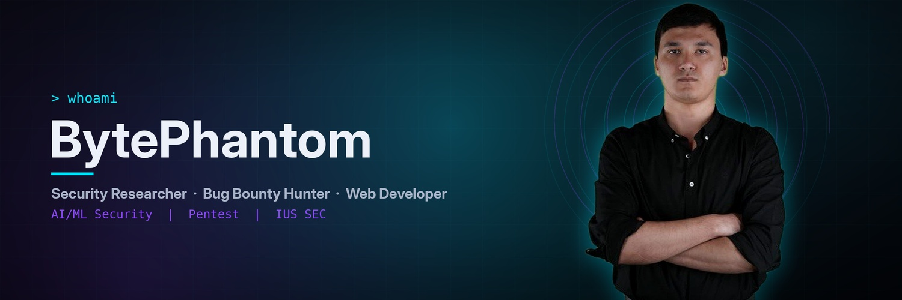

<!-- BytePhantom0606 :: profile README -->
<p align="center">
  
</p>

<p align="center">
  <a href="https://github.com/BytePhantom0606">
    
  </a>
</p>

<p align="center">
  
  
  
</p>

---

### `> cat /etc/operator.conf`

```yaml
operator:   Ali Sadullaev
handle:     BytePhantom0606
role:       [ Security Researcher, Bug Bounty Hunter, Web Developer ]
team:       IUS SEC
os:         Kali Linux
focus:
  - Web Application Security   # OWASP Top 10, API, auth flaws
  - AI/ML Security              # LLM prompt injection, model abuse
  - Active Directory Attacks    # Kerberos, ACL abuse, lateral movement
  - Recon & Automation          # Python / Bash pipelines
  - CTF Lab Engineering         # building vulnerable labs & challenges
motto:      "Attack the system. Understand the system. Secure the system."
```

---

### `> ls ~/arsenal/`

<p align="left">
  
</p>

| Category | Tools |
|---|---|
| **Recon** |      |
| **Web** |    |
| **Exploitation** |     |
| **Cracking** |    |
| **Infra / Lab** |    |

---

### `> ./stats.sh --user BytePhantom0606`

<p align="center">
  
  
</p>

<p align="center">
  
</p>

---

### `> cat /var/log/current_ops.log`

```diff
+ [ACTIVE]   Hunting on public bug bounty programs
+ [ACTIVE]   Building CTF labs: web, privesc, Active Directory
+ [ACTIVE]   Researching AI/ML & LLM application security
+ [LEARNING] Advanced AD exploitation & cloud attack paths
- [BLOCKED]  Sleep
```

---

<p align="center">
  <a href="https://hackerone.com/rh06"></a>
  <a href="https://profile.hackthebox.com/profile/019d57d5-1d55-70ff-bb92-2489afff4a9f"></a>
  <a href="https://www.linkedin.com/in/ali-sadullaev-7b14a3362"></a>
  <a href="https://t.me/bytephant0m"></a>
</p>

<p align="center">
  
</p>
